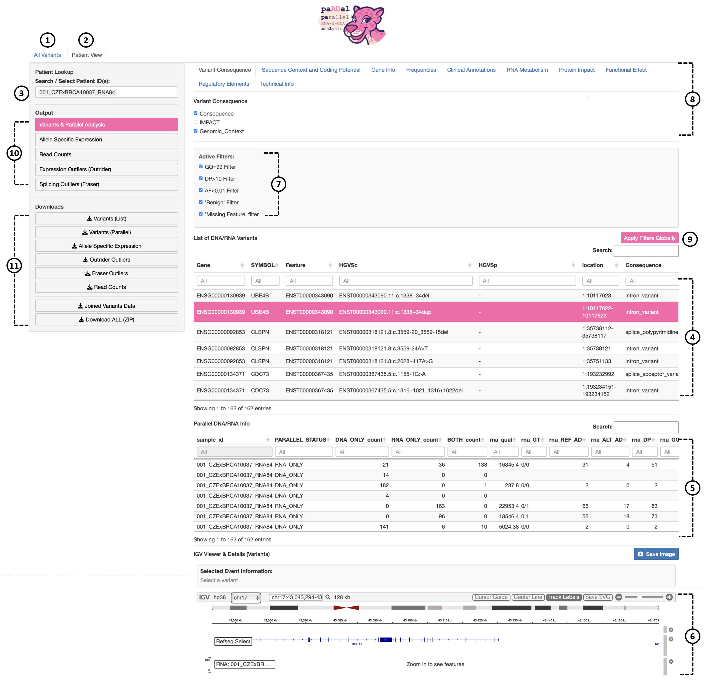

# Pardal-app

Pardal-app is containerized using Docker and requires specific input files from the Pardal application (https://github.com/LOG-CZECANCA/pardal) to function properly.

## Requirements

- Docker

## Quick Start

   **Clone git repository:**
   ```bash
   git clone https://github.com/LOG-CZECANCA/pardal-app
   ```

   **Download the Docker image:**
   ```bash
   wget https://s3.cl4.du.cesnet.cz/023f5ea5_f367_4868_be9d_86b4305c8c91:pardal/pardal-app.tar
   docker load -i ./pardal-app.tar
   rm ./pardal-app.tar
   ```

   **Get libraries and files:**
   ```bash
   cd pardal-app
   wget https://s3.cl4.du.cesnet.cz/023f5ea5_f367_4868_be9d_86b4305c8c91:pardal/pardal-app-env.tar
   tar xvf ./pardal-app-env.tar
   rm ./pardal-app-env.tar
   ```

   **Copy files from Pardal:**

   Before running the application, you need to copy the following files from your Pardal application directory to the Shiny application directory:

   Directories FIN_TAB, R_FEATURE_COUNTS, SAMPLE_IDENTITY, R_FRASER, R_ASE, R_OUTRIDER from the pardal/Results copy to the pardal-app directory.

   File sample_pairs.txt from pardal/Input copy to the pardal-app/Input directory.

   Directories D_RMDUP_BAM, R_RMDUP_BAM copy to the pardal-app/www.


```
pardal-app/
├── Input/
│   ├── Homo_sapiens.GRCh38.114.gtf.gz
│   ├── exons_gr.rds
│   ├── introns_gr.rds
│   ├── sample_pairs.txt
│   └── txdb.sqlite
│
├── www/
│   ├── D_RMDUP_BAM/
│   ├── R_RMDUP_BAM/
│   ├── tmp_bam_slices/
│   ├── pardal.jpg
│   ├── reference/
│   └── txdb.sqlite
│
├── FIN_TAB/
├── R_ASE/
├── R_FEATURE_COUNTS/
├── R_FRASER/
├── R_OUTRIDER/
└── SAMPLE_IDENTITY/
```

   **Important Notes:**
-  The www/tmp_bam_slices directory is used for temporary storage of BAM file slices during processing
-  Insufficient write permissions will cause the application to fail during BAM file operations
-  Ensure the Docker user has write access to this directory before starting the container
-  This directory may contain temporary files that can be safely deleted after processing


   **Start the Pardal-app:**
   ```bash
   cd pardal-app
   docker run -it -p 3838:3838 -v $PWD:/srv/shiny-server/pardal pardal-app
   ```
   
   Open your web browser and navigate to http://localhost:3838
   

   **The paRDal application layout:**

The paRDal application allows to choose All Variants view (1) or Patient View (2) showing all variants in entire analyzed cohort (e.g. sequencing run) or variants identified in a given individual (3), respectively. List of DNA/RNA Variants (4) includes all detected variants (in parallel DNA and RNA seqs), Parallel DNA/RNA Info (5) discloses their quality metrics. Upon clicking (not shown) selected variant is displayed in parallel DNA/RNA tracks in IGV (6). Variants are prefiltered using switchable filters (7). Shown variants could be annotated using various VEP plugins clustered into thematically relevant groups (8). Clicking on Apply Filters Globally (9) allows to apply selected feature (e.g. variant or gene) on other functional layers (Output (10)) in paRDal, which can be downloaded in csv format (11).

   <div align="center">
     
   </div>


  


